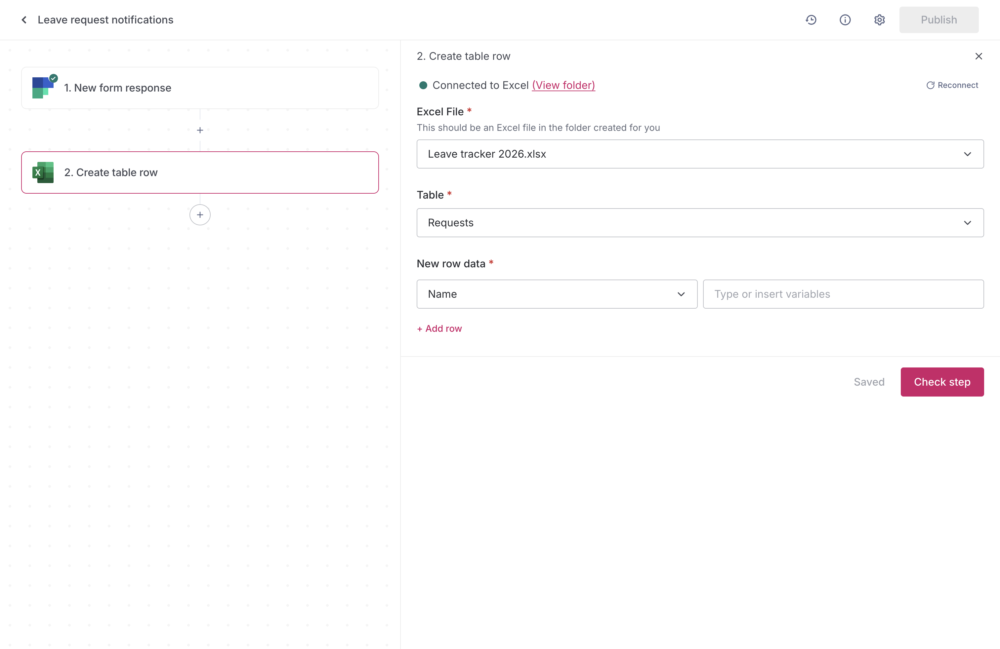
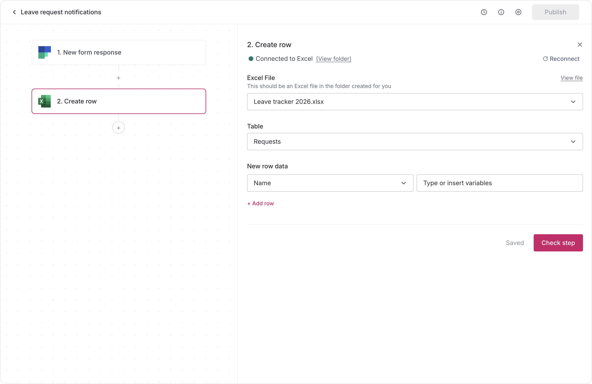

# Frontend UI polish

This branch refines the flow editor. It changes only frontend styling. No behavior, data or backend code changes.

## Before and after

The screenshots come from the Paper design file. They show the M365 Excel "Create row" step with the step drawer open.

| Before (current product) | After (this branch) |
| --- | --- |
|  |  |

## What changed

| Area | Before | After | Source |
| --- | --- | --- | --- |
| Selected step card border | 1px brand border | 1.5px brand border. The card grows by 0.5px per side, so content does not shift. | `FlowStep/styles.ts`, `FlowStep/index.tsx` |
| Banner above a selected step | 1px border | 1.5px border, matching the card. Unselected banners are unchanged. | `FlowStep/styles.ts`, `FlowStep/components/TestAgainInfobox.tsx` |
| Drawer step title | Default size and weight | 18px, weight 500, strong text colour. The size and weight stay the same while editing. | `EditorRightDrawer/StepHeader.tsx`, `EditableInput/index.tsx` |
| Drawer title position | At the top of the drawer | 20px lower, to line up with the first step card. The content below moves down to match. | `EditorRightDrawer/styles.ts` |
| "View" link on dropdown fields | Inline after the label, as "(View tile)" | On the label row, flush right, grey, as "View tile". It darkens on hover. | `ControlledAutocomplete/index.tsx` |
| Space between fields in a step | 28px | 32px | `FlowSubstep/index.tsx` |
| Space between the last field and the test bar divider | 16px | 40px | `FlowSubstep/index.tsx` |
| Test bar vertical padding | 16px | 24px | `FlowStepTestController/styles.ts` |

## Not changed

- Step card corner radius stays `lg` (8px).
- Selecting a step does not scale the card.
- Buttons keep the design system radius of 4px.

## Known gaps

- The screenshots are design mockups, not captures of the running app.
- The "Before" mockup also shows items outside this branch, such as required-field asterisks and the step name "Create table row". Ignore those when comparing.
